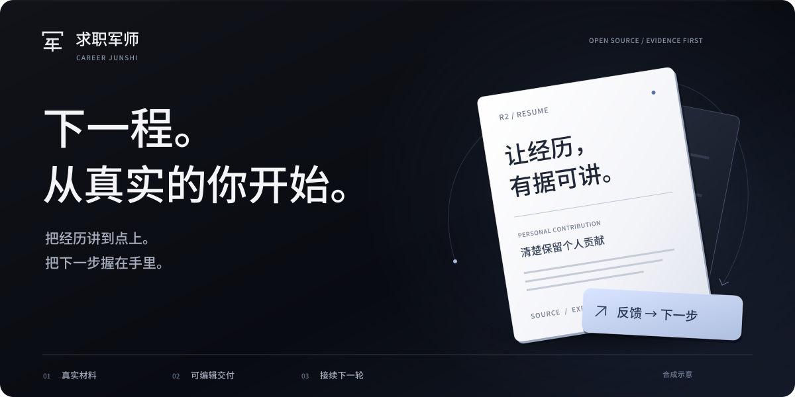
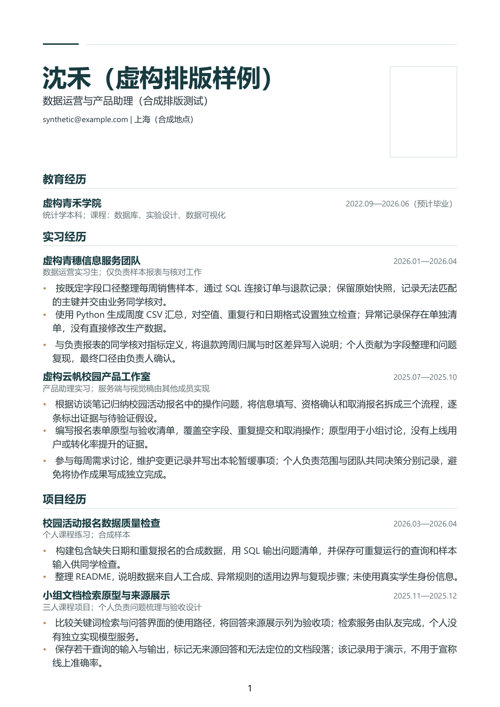

<a id="top"></a>

<div align="center">

[](#start)

**用 AI 做出项目，用自己的理解证明价值。**

<sub>求职军师 · Career Junshi — 运行在助手中的求职 Skill，从你手边的材料开始。</sub>

<p>
  <a href="#start"></a>
</p>

[开始使用](#start) &nbsp; · &nbsp; [交付样例](#demo) &nbsp; · &nbsp; [投递助手](#autofill) &nbsp; · &nbsp; [常见问题](#boundaries) &nbsp; · &nbsp; [English](README_EN.md)

</div>

---

## 这是给谁的？

做过项目，却不知道简历怎么写、面试时怎么讲；尤其是用 AI Coding 做项目、难以区分自己与 AI 或队友贡献的求职者。

Career-Junshi 是运行在 Codex 等支持本地 Skill 的助手中的求职教练。不需要完整简历，也不需要学习一套求职框架。先带一段经历，拿到能用的表达，再练一次真实追问。

<a id="start"></a>

## 快速开始：安装 → 给一段经历

### 1. 安装到你的助手

把这段发给 Codex 等支持本地 Skill、能运行本地命令的助手。安装器需要 Python 3.10+：

```text
请将 https://github.com/lavine888/Career-Junshi 的 main 分支
安装为 career-junshi 本地 Skill，使用仓库安装器。
先检查已有同名安装，不要覆盖；安装后验证运行文件。
不要替我启用长期记忆。
```

### 2. 带来手边的一点材料

```text
请用 $career-junshi。
这是我的一段项目经历：……
帮我讲清个人贡献。材料够用时先给一段可用表达，
再一次只问一个针对性问题，等我回答后改进表达。
先在聊天中完成，不生成文件、不启用长期记忆。
```

**这一轮应该完成：** 你提供经历 → 得到可用表达 → 回答一个针对性问题 → 得到根据回答改进的表达。

不用先补完整简历或 JD；材料不足时，只问最关键的一件事。只有 GitHub 也能开始，
[看项目起步示意](cases/experiences/public-projects/example.md)。
如果助手无法调用 Skill，先请它核对安装路径是否属于当前助手读取的 Skill 目录。

<details>
<summary>手动安装 · 需要 Git 与 Python 3.10+ · 仅标准库</summary>

```sh
git clone --branch main https://github.com/lavine888/Career-Junshi.git
cd Career-Junshi
python scripts/validate_skill.py
python scripts/install_skill.py --target /path/to/your/skills/career-junshi
python /path/to/your/skills/career-junshi/scripts/validate_skill.py --runtime-only
```

替换为宿主实际读取的目录，Windows 同样使用实际路径；目标文件夹须名为
`career-junshi`，已有目标会保留并报错。安装只复制运行文件和许可，不带案例、
测试、`.git` 或数据库，也不会开启记忆。符号链接与 Windows 目录联接路径会被拒绝。

</details>

<a id="demo"></a>

## 交付样例：表达怎么变清楚

> **原句**：「独立开发生产级 RAG 平台，准确率提升 30%。」

实际材料是团队课程原型：本人负责评测脚本和失败分类，队友实现服务；
跑过 10 条内部问题，没有基线，也没有生产用户。追问个人工作与判断标准后：

> 参与团队课程 RAG 原型开发，负责评测脚本与失败分类，按团队约定标准完成
> 10 条内部问题评测，记录缺少文档引用、引用段落错误及回答与文档冲突三类问题。

**留下可用表述，也标清还缺什么。** 没有效果数据，不抹掉你做过的工作，也不补写成果。

<sub>改写自合成材料的实际宿主试用，非真人简历或招聘结果。[查看记录](documentation/EVOLUTION_EVAL.md)</sub>

<details>
<summary>看这句改写背后的一次追问</summary>

```text
军师：这 10 条问题里，你用什么标准判定一条回答失败？

你：我和队友约定了三类：没有文档引用、引用段落错误、内容与文档冲突。
    我把检查写进脚本并记录结果。

军师：个人贡献更清楚了。目前仍是你的自述，代码和评测记录还需要核验。
```

[完整守城示意](cases/experiences/defense/example.md)为另行编写的合成案例。

</details>

<a id="experiences"></a>
<a id="interview-loop"></a>

## 四件事，随时开始

| 你现在卡在哪里 | 直接对军师说 | 你会拿到什么 |
| --- | --- | --- |
| 经历说不清 | “帮我改这段项目经历，保留真实贡献。” | 可用表达、一个关键追问 |
| 不知道投什么 | “这份 JD 值不值得投？” | 投递判断、关键缺口、下一步 |
| 面试怕被问穿 | “围绕这个项目，一次问我一道题。” | 根据实际回答纠偏、变题复练 |
| 面试结束或收到 Offer | “这是新的反馈，帮我调整下一步。” | 复盘、优先级或 Offer 取舍 |

只要一句就给一句；想练就一题一题来；想停随时停。不用记内部体验名。

[更多实战案例](cases/experiences) · [完整任务索引](references/practical/00-router.md)

<a id="journey"></a>

## 每次求职，都为下一次积累

**真实经历 → 简历版本 → 实际投递 → 面试反馈 → 下一步**

已投版本不被新版本覆盖；面试反馈不被当成录用原因。默认只在聊天中工作，需要下次继续时，可以让军师生成一张简短接续卡，再主动带回。

> 请用 $career-junshi，继续我的求职。这是上次的接续卡，这次发生了：…… 只给我最值得做的下一步。

持久记忆另行授权，默认关闭。[接续机制](references/practical/job-search-journey.md) · [隐私与记忆](documentation/MEMORY.md)

<a id="resume-export"></a>

<details>
<summary>需要简历文件？看 LaTeX / PDF 样例和导出提示词</summary>

### 一份可以继续编辑的简历

从岗位表达到排版，保留同一套事实。可交付 **LaTeX 源码、纯文本**；
本机具备 XeLaTeX 时，再编译、检查 PDF。精排版可预留照片位。

<p align="center">
  <a href="benchmark/journey-20261021/artifacts/editorial-zh/resume.pdf">
    
  </a>
  <br>
  <sub>实际编译的合成样例 · 可预留照片位 · 点击查看 PDF</sub>
</p>

<p align="center">
  <a href="benchmark/journey-20261021/artifacts/editorial-zh/resume.pdf">查看 PDF ↗</a>
  &nbsp; · &nbsp;
  <a href="benchmark/journey-20261021/artifacts/editorial-zh/resume.tex">查看 LaTeX 源码</a>
</p>

**复制这段请求：**

```text
请用 $career-junshi，按这份 JD 整理中文单栏简历，优先一页。
使用精排版，预留照片位。保留真实贡献，说明重要改写与删留。
导出 LaTeX 源码和纯文本到我指定的新私有目录。
本机有 XeLaTeX 时再编译 PDF，说明内容、编译、文字层和版面检查结果。
```

`resume.txt` 可粘贴到 Word 等编辑器，它是纯文本，不是 Word 文档。
`resume.tex` 用于继续排版；`resume.pdf` 只有实际生成并检查后才作为 PDF 交付。
材料与文件写入你指定、位于 Git 仓库和 Skill 安装目录之外的私有位置。

</details>

<a id="autofill"></a>

## 可选：招聘官网少填几遍资料

[下载军师投递助手 v0.3.2（含本地 OCR / PDF 组件）](https://github.com/lavine888/Career-Junshi/releases/download/autofill-v0.3.2/junshi-autofill-0.3.2.zip)

在 Edge / Chrome 中读取你选择的简历，识别中英文字段并填入确定项。**本地模式无需模型 API 密钥**；
图片或扫描 PDF 可用本地 OCR。填表、投递记录、设置分开，首次使用不必配置模型。

1. 下载并解压 ZIP，保留解压后的 `junshi-autofill` 文件夹。
2. 打开 `edge://extensions` 或 `chrome://extensions`，开启开发人员模式，点击“加载解压缩的扩展”，选择包含 `manifest.json` 的文件夹。
3. 打开招聘表单，点击扩展图标：**导入并核对简历 → 识别并填入确定项 → 检查网页 → 本人提交 → 确认记录投递**。

可选接 DeepSeek / 智谱等 API，默认只发送字段结构；发送简历内容需主动选择并预览。
也可将复杂字段交给现有军师。模型结果先核对，开放题逐项确认；已投记录可交回军师，继续面试准备或跟进。

不承诺所有官网兼容；OCR 只识字，不能代替开放题理解。自定义控件、附件上传和不确定项需要本人处理，插件不自动提交。

**旧版升级：** 先备份记录，更新原加载文件夹后重新加载，不要先卸载；本次需重新导入简历，历史投递保留。

[完整使用说明与限制](extensions/autofill/README.md) · [可选 API 配置](extensions/autofill/README.md#可选接入国内模型-api)

<a id="evaluation"></a>

## 验证进度

- 历史软件回归：286 项，285 通过、1 项因文件符号链接权限跳过。[记录](documentation/HUMAN_LOOP_EVAL.md)
- 已有合成多轮试用、简历 PDF 实际编译及边界验收。[评测索引](documentation/EVAL.md) · [简历排版](benchmark/resume-layout-20261020/README.md)
- 五人真人首用对照尚未收集结果。[试用协议](documentation/EVAL.md#core-first-use-trial)

以上为已有版本的验证记录，不是本轮精简版重测结果；不能证明提升面试通过率、Offer 率或谈薪结果。冻结案例仍有提取、交接和泛化方面的局限。[冻结 Holdout](documentation/V023_HOLDOUT_EVAL.md)

<a id="boundaries"></a>
<a id="library"></a>

## 常见问题

<details>
<summary>没有 JD、完整简历或 LaTeX，也能用吗？</summary>

可以，从一段经历、项目链接或招聘消息开始。没有 JD 时，岗位建议是待验证假设。
没有 XeLaTeX 时仍可交付源码与纯文本，PDF 保持未编译、未验证。

PDF 编译需要 XeLaTeX、CTEX/Fandol、geometry、hyperref 及其依赖；精排版另需
fontspec、xcolor、graphicx。运行 `python scripts/junshi.py resume-doctor` 可实际编译
中英文合成小样检查环境，不读取你的简历、不安装组件。`READY` 只说明小样通过；
实际简历还需单独验收，文字提取不等于通用 ATS 认证。
[完整导出流程](references/practical/resume-export.md)

</details>

<details>
<summary>会自动记住我，或替我投递、发消息吗？</summary>

默认不会自动跨聊天记住你，也不会自动读取个人目录。把接续卡主动带回来即可继续。
长期记忆另需同意，支持查看、暂停、撤销和删除；默认不保存完整简历、JD 或聊天。
数据库位于 Git 与安装目录外，未加密；删除不保证擦除外部备份，宿主仍有自己的数据政策。

军师准备材料与草稿，实际投递、发送、谈薪和接受 Offer 由你决定并执行。
[记忆说明](documentation/MEMORY.md) · [证据契约](documentation/EVIDENCE.md)

</details>

<details>
<summary>建议有什么依据？哪些结论不能下？</summary>

[职业参考库](references/knowledge/08-research-and-application.md)按阅读深度、适用范围
和限制整理研究与官方资料。可以直接问：“这个建议依据什么，哪些情况不适用？”

当前招聘、公司、薪资和个案法律信息需新鲜来源；不编造职责、指标或归属。
单次沉默或拒绝不足以判断职业方向，不提供候选人综合分数或录用概率。

</details>

---

<details>
<summary>开发者入口与手动验证</summary>

[Skill 入口](SKILL.md) · [任务指南](references) · [合成案例](cases) ·
[架构](documentation/ARCHITECTURE.md) · [问题与建议](https://github.com/lavine888/Career-Junshi/issues)

宿主理解材料并进行互动判断；Python 提供有界的结构化辅助、产物与可选记忆。
`route --experience` 只选择参考，不自动运行对话或生成报告。

```sh
python -m unittest discover -s tests -v
python scripts/validate_skill.py
python scripts/benchmark.py run
python scripts/junshi.py route --mode interview --experience defense
python scripts/junshi.py sources --topic interview
```

浏览器插件的检查与限制见[插件说明](extensions/autofill/README.md#边界与验证)；上面的 Python 命令不包含插件浏览器测试。

[提取契约](documentation/CONTEXT_EXTRACTION.md) ·
[决策契约](documentation/DECISION_INTELLIGENCE.md) ·
[可选快照集成](documentation/INTEGRATION.md)

独立的 [v0.3 Host-First 实验](https://github.com/lavine888/Career-Junshi/tree/experiment/v0.3-host-first)
尚未完成，其结果不代表当前版本的架构结论。

</details>

<div align="center">

[开始这一轮 ↑](#start) &nbsp; · &nbsp; [官网 ↗](https://career-junshi.lavinex.chatgpt.site) &nbsp; · &nbsp; [GitHub Issues](https://github.com/lavine888/Career-Junshi/issues)

<sub>[MIT](LICENSE) · Python 3.10+ · [English](README_EN.md) · [回到顶部](#top)</sub>

</div>
