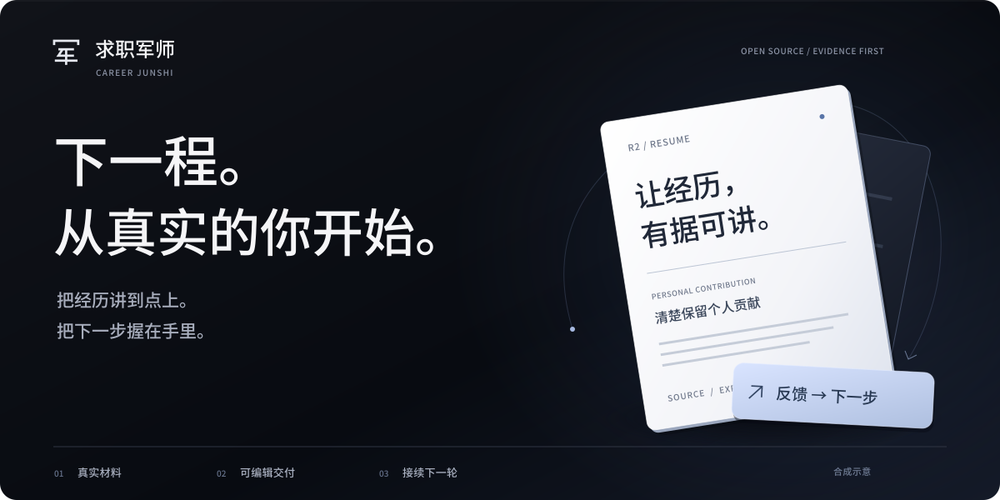
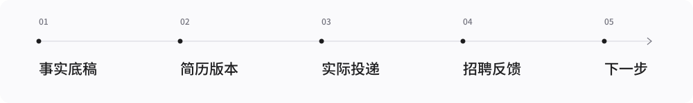

<a id="top"></a>

<div align="center">

[](https://career-junshi.lavinex.chatgpt.site)

# 求职军师 · Career Junshi

运行在助手中的职业决策 Skill。基于真实经历，改简历、练面试，把反馈接回下一步。

<p align="center">
  <a href="https://career-junshi.lavinex.chatgpt.site"></a>
  &nbsp;
  <a href="#start"></a>
</p>

[简历样例](#resume-export) &nbsp; · &nbsp; [English](README_EN.md)

<sub>[MIT](LICENSE) &nbsp; · &nbsp; Python 3.10+ &nbsp; · &nbsp; [记忆自选](documentation/MEMORY.md)</sub>

</div>

---

[01 看效果](#demo) · [02 开始用](#start) · [03 选入口](#experiences) · [04 拿成稿](#resume-export) · [05 接着走](#journey) · [06 看验证](#evaluation) · [07 了解边界](#boundaries)

<a id="demo"></a>

## 01 / 让一段经历，有据可讲

> **原句**：「独立开发生产级 RAG 平台，准确率提升 30%。」

实际做的是团队课程原型：本人负责评测脚本和失败分类，队友实现服务。
跑过 10 条内部问题，没有基线，也没有生产用户。军师先追问个人工作和判断标准，再给可用表述：

> 参与团队课程 RAG 原型开发，负责评测脚本与失败分类，按团队约定标准完成
> 10 条内部问题评测，记录缺少文档引用、引用段落错误及回答与文档冲突三类问题。

你拿到的是**贡献范围清楚的表达、仍需补充的证据、下一步行动**。

<sub>改写自合成材料的实际宿主试用，非真人简历或招聘结果。[试用记录](documentation/EVOLUTION_EVAL.md)</sub>

<details>
<summary>展开看：军师如何追问</summary>

```text
军师：这 10 条问题里，你用什么标准判定一条回答失败？

你：我和队友约定了三类：没有文档引用、引用段落错误、内容与文档冲突。
    我把检查写进脚本并记录结果。

军师：个人贡献更清楚了。目前仍是你的自述，代码和评测记录还需要核验。
```

[完整守城示意](cases/experiences/defense/example.md)为另行编写的合成案例。

</details>

<a id="start"></a>

## 02 / 两步，开始这一轮

### 1. 安装到你的助手

把下面这段发给 Codex 等支持本地 Skill 的助手：

```text
请将 https://github.com/lavine888/Career-Junshi 的 main 分支
安装为 career-junshi 本地 Skill，使用仓库安装器。
先检查已有同名安装，不要覆盖；安装后验证运行文件。
不要替我启用长期记忆。
```

<details>
<summary>手动安装 · Python 3.10+ · 仅标准库</summary>

```sh
git clone --branch main https://github.com/lavine888/Career-Junshi.git
cd Career-Junshi
python scripts/validate_skill.py
python scripts/install_skill.py --target /path/to/your/skills/career-junshi
python /path/to/your/skills/career-junshi/scripts/validate_skill.py --runtime-only
```

将 `/path/to/your/skills` 替换为宿主实际读取的目录，Windows 同样传入实际路径。
目标文件夹须名为 `career-junshi`；已有目标会保留并报错。
安装只复制运行文件与许可，不带案例、测试、`.git` 或数据库，也不会开启记忆。

</details>

### 2. 发来一段真实材料

```text
请使用 $career-junshi，帮我改这段经历。

我的简历写：……
我实际做过：……
目标岗位 / JD：……
最近面试或截止时间：……

给我可用的改写、重要修改的依据，以及最值得补的一步。
```

没有完整简历也能开始；JD、截止时间不知道可以留空。
已有材料先用，只补问会改变判断的信息。想练追问时，加一句“带我做简历守城，一次问一个问题”。

<a id="experiences"></a>

## 03 / 四种入口，共用一套事实

| 核心体验 | 直接这样说 | 带走什么 |
| --- | --- | --- |
| **简历守城** · 怕项目被问穿 | “追问这句经历，一次问一个问题。” | 个人贡献、证据缺口、可用表述 |
| **岗位表达** · 同一项目投不同岗位 | “适配这两份 JD，解释每版删留。” | 共用事实底稿、岗位版本、取舍理由 |
| **补证冲刺** · 缺证据，不知从何下手 | “本周有 4 小时，补一个关键缺口。” | 具体产物、验收条件、时间预算、停止线 |
| **决策复盘** · 收到反馈，不知怎么改 | “对照上次建议和这次反馈，调整下一步。” | 原判断与观察对照、修正动作 |

可以从任一环节进入，随时停止；不同岗位版本沿用同一套事实。

[守城案例](cases/experiences/defense/example.md) · [岗位表达](cases/experiences/role-translation/example.md) ·
[补证冲刺](cases/experiences/proof-sprint/example.md) · [决策复盘](cases/experiences/decision-review/example.md)

<details>
<summary>展开看：更多请求与进阶用法</summary>

| 直接这样说 | 军师会帮你做什么 |
| --- | --- |
| “我该主投哪个方向？” | 对照目标、经历与当前 JD，给主投 / 副投 / 探索及验证动作 |
| “按这份 JD 模拟面试，先说这题看什么。” | 明确职责与观察点，一次一问，依据实际回答反馈 |
| “明天二面，今晚只有 90 分钟。” | 收敛最高风险和 1–3 个动作，给今晚的停止线 |
| “HR 五天没回，要不要催？” | 核对对话、承诺日期和工作日，给时机、草稿与停止等待条件 |
| “两个 Offer 怎么选，哪些条件先核实？” | 对照目标与书面条款，核实决定性未知；处理实际费用或身份风险 |
| “两版简历反馈不同，设计一次投递实验。” | 选可比岗位、只改一项，保留版本、分母和观察窗口 |
| “只有 15 分钟，一直在换模板，帮我开始。” | 给一个可检查的小结果、开始触发点、备用做法和停止时间 |

- **措辞核对**：“只改动词、贡献和因果中缺证据的部分。”[示意](cases/experiences/wording-audit/example.md)
- **断点续练**：“先停，给我可复制的断点。”下次贴回继续，默认留在聊天。[示意](cases/experiences/defense-resume/example.md)
- **隐藏结果复盘**：在未见结果的新聊天中先提供观察，固定初判后再揭晓结果；已知结果时按普通复盘处理。[示意](cases/experiences/outcome-blind-review/example.md)

不同岗位或渠道的结果不能直接归因于模板，未到观察窗口的投递保持待观察。
[投递实验](cases/experiences/job-search-experiment/example.md) · [行动启动卡](cases/experiences/action-start/example.md)

</details>

<a id="resume-export"></a>

## 04 / 从改写，到一份完整交付

先看清**原句 → 改写 → 理由 → 待核实事实**，以及经历为什么被前置、压缩或省略。
再导出单栏简历：基础版保留独立日期行，精排版将日期与标题对齐，使用深墨绿标题、铜色细节与可选照片空位。两版都保留可编辑源码、来源与实际验收。

<p align="center">
  <a href="benchmark/journey-20261021/artifacts/editorial-zh/resume.pdf">
    
  </a>
  <br>
  <sub>实际编译的精排合成样例 · 已留照片位 · 点击查看 PDF</sub>
</p>

<details>
<summary>复制简历导出请求</summary>

```text
按这份 JD 整理中文单栏简历，优先一页；使用精排版，预留照片位。
保留真实贡献，说明重要改写与删留；普通润色直接完成。
导出 LaTeX 源码和纯文本到我指定的新私有目录。
本机有 XeLaTeX 时再编译 PDF，分别说明内容、编译、文字层和页面检查结果。
```

</details>

| 接下来想做什么 | 打开哪个文件 |
| --- | --- |
| 复制或继续改内容，不使用 LaTeX | **`resume.txt`**，可粘贴到 Word 等编辑器；它是纯文本，不是 Word 文档 |
| 调整 LaTeX 排版 | **`resume.tex`**，用 TeX 编辑器打开 |
| 查看或投递 PDF | 实际生成且检查后的 **`resume.pdf`**，同时查看交付说明 |

来源数据和验收 JSON 作为次要查验材料保留。没有编译器时仍可交付源码和纯文本，PDF 页数与版面保持未验证。

[两页样例](benchmark/resume-layout-20261020/artifacts/two-page-zh/resume.pdf) ·
[长链接样例](benchmark/resume-layout-20261020/artifacts/links-mixed/resume.pdf) ·
[实际验收](documentation/RESUME_ITERATION_EVAL.md)（均为虚构材料）

<details>
<summary>编译与自检 · 文件存放 · 检查边界</summary>

源码导出不需要 LaTeX；PDF 编译需要本机 XeLaTeX、CTEX/Fandol、geometry、hyperref 及其依赖；精排版另需 fontspec、xcolor 和 graphicx。
环境不确定时，在仓库或已安装 Skill 的根目录运行：

```sh
python scripts/junshi.py resume-doctor
```

自检会编译中英文合成小样，报告实际工具路径、版本和文字提取结果，不读取你的简历，也不安装组件。
`READY` 表示小样通过；`NOT_READY` 返回失败检查，源码导出仍可使用。

实际简历另外检查内容、编译日志、文字覆盖、阅读顺序、重复次数及每页版面。
可选 1 或 2 页，不自动缩字或删除实质内容；未完成的检查明确标注，文字提取不等于通用 ATS 认证。
个人文件放在仓库和 Skill 安装之外、由你指定的新目录中。

[合成输入与交付示意](cases/experiences/resume-export/example.md) · [完整导出流程](references/practical/resume-export.md)

</details>

<a id="journey"></a>

## 05 / 每一轮，都接得上



- **保留已经发生的。** 已投 R1 不被覆盖；修订生成 R2，补交单独记录，不重复计算初始投递。
- **让反馈改变具体动作。** 岗位取消调整该机会投入；明确的能力反馈指向练习或补证。
- **下次回来继续。** 接续卡记录机会、实际版本、已做与未做的动作、反馈来源和下一步。

<details>
<summary>复制下次继续的提示词</summary>

```text
使用 $career-junshi，继续我的求职。
这份是上次的接续卡／记录，这次发生了：……
对照当时的建议，说明哪些已做、哪些仍未知，给我一个下一步。
如果需要改简历，保留原投递版本并生成新版；最后更新接续卡。
先在聊天里处理，不开启长期记忆。
```

</details>

默认只在聊天中交付。明确要求私有接续文件后，才生成记录、检查结果和 `continue.md`；
下次主动带回即可。不会自动读取个人目录、开启记忆、投递或发消息。
[完整接续契约](references/practical/job-search-journey.md) · [合成起点](cases/experiences/journey/request.md) · [实际验收](documentation/JOURNEY_EVAL.md)

<a id="evaluation"></a>

## 06 / 验证，留在可查看的地方

| 检查范围 | 已完成 | 查看记录 |
| --- | --- | --- |
| 自动化回归 | **262 项测试**，含两条连续求职流程、版本纠正与安装后接续 | [闭环验收](documentation/JOURNEY_EVAL.md) |
| 实际 PDF 编译 | **4 个场景、8 页**；三个正例通过，超页负例被拒绝 | [排版压力测试](benchmark/resume-layout-20261020/README.md) |
| 本轮闭环与精排 | **3 份合成 PDF、3 页**；新上下文子代理完成两轮接续试用 | [闭环验收](documentation/JOURNEY_EVAL.md) |
| 模拟用户交互 | **5 个合成用户、15 轮实际交互** | [多轮试用](documentation/MOCK_USER_TRIALS.md) |

另有 13 个结构化合成基准与有限的新上下文试用。这些结果不能证明提高面试通过率或 Offer 率。

<details>
<summary>历史验收与已知限制</summary>

| 范围 | 记录 |
| --- | --- |
| 四个核心体验 | [核心体验验收](documentation/EVOLUTION_EVAL.md) |
| 措辞核对、断点续练、隐藏结果复盘 | [细节验收](documentation/REFINEMENT_EVAL.md) |
| 简历源码导出与 PDF 检查边界 | [导出验收](documentation/RESUME_EXPORT_EVAL.md) |
| 投递实验、行动启动、研究外推 | [研究工作流验收](documentation/RESEARCH_EVOLUTION_EVAL.md) |
| 参考库、结构化面试、Offer 核验 | [参考库验收](documentation/CAREER_LIBRARY_EVAL.md) |
| 新手与 LaTeX 用户的文件选择 | [交付改进验收](documentation/EXPORT_HANDOFF_EVAL.md) |
| 改写对照、自检与实际编译 | [本轮验收](documentation/RESUME_ITERATION_EVAL.md) |

既有冻结案例仍有提取、交接和建议泛化等弱点，未全部重测，也未宣称达到原有真实用户试点门槛。
当前招聘、薪资与公司信息需新鲜来源，不提供候选人综合分数或录用概率。

[评测协议](documentation/EVAL.md) · [冻结 Holdout](documentation/V023_HOLDOUT_EVAL.md) · [体验方案](documentation/EVOLUTION_PLAN.md)

</details>

<a id="boundaries"></a>
<a id="library"></a>

## 07 / 事实、记忆与选择的边界

**事实可追溯，记忆由你开启，对外行动由你决定。**

<details>
<summary>没有完整简历、JD 或 LaTeX，也能开始吗？</summary>

可以。从一段项目经历、一条招聘消息或一个具体问题开始。没有 JD 时，岗位建议仍是待验证假设。
没有 XeLaTeX 时可交付源码和纯文本，PDF 保持未编译、未验证。

</details>

<details>
<summary>下次会自动记住我吗？资料存在哪里？</summary>

默认不会自动跨聊天记住你。把接续卡或明确要求生成的私有记录带回来即可继续；不会自动读取个人目录。

长期记忆需要另外同意，默认不保存完整简历、JD 或聊天，支持查看、暂停、撤销与删除。
本地数据库未加密，删除不保证擦除外部备份；对话材料仍受宿主数据政策约束。

[记忆说明](documentation/MEMORY.md) · [证据契约](documentation/EVIDENCE.md)

</details>

<details>
<summary>建议依据什么？哪些结论还不能下？</summary>

职业参考库收录 18 条独立研究与官方资料，覆盖八个主题。每条记录阅读深度、适用范围与限制。
可以直接问：“这个建议有什么依据，哪些情况不适用？”

当前招聘、薪资、公司与个案法律信息需核对新鲜来源。单次沉默或拒绝不足以判断整个职业方向，也不提供候选人综合分数或录用概率。

[职业参考库](references/knowledge/08-research-and-application.md)

</details>

<details>
<summary>会替我投递、发消息或接受 Offer 吗？</summary>

军师可以准备材料、沟通草稿和下一步行动。实际投递、发消息、谈薪、接受 Offer 与分享由你决定并执行。
报告默认留在聊天，要文件时再指定目录。现有验证不能证明提高面试或 Offer 率。

</details>

---

## 开发与文档

[Skill 入口](SKILL.md) · [任务指南](references) · [合成案例](cases) · [架构](documentation/ARCHITECTURE.md) · [问题与建议](https://github.com/lavine888/Career-Junshi/issues)

<details>
<summary>开发命令与实现说明</summary>

宿主理解材料和互动判断；Python 提供有界的结构化辅助、产物与可选记忆。
`route --experience` 只选择参考，不会自动运行对话或生成报告。

```sh
python -m unittest discover -s tests -v
python scripts/validate_skill.py
python scripts/benchmark.py run
python scripts/junshi.py route --mode interview --experience defense
python scripts/junshi.py sources --topic interview
python scripts/junshi.py sources --id R7
```

[测试](tests) · [提取契约](documentation/CONTEXT_EXTRACTION.md) · [决策契约](documentation/DECISION_INTELLIGENCE.md) · [可选快照集成](documentation/INTEGRATION.md)

独立的 [v0.3 Host-First 实验](https://github.com/lavine888/Career-Junshi/tree/experiment/v0.3-host-first)尚未完成，其结果不代表当前版本的架构结论。

</details>

---

<div align="center">

[官网 ↗](https://career-junshi.lavinex.chatgpt.site) · [GitHub Issues](https://github.com/lavine888/Career-Junshi/issues) · [MIT](LICENSE) · [回到顶部 ↑](#top)

</div>
