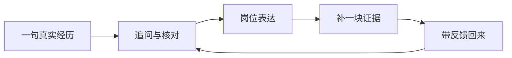

<div align="center">


# 求职军师 · Career Junshi

### 把真实经历，写成经得起追问的简历。

从一句项目经历开始，讲清个人贡献、补齐关键证据，再决定下一步。

[](LICENSE)

[](documentation/MEMORY.md)

[看一次守城](#demo) · [开始使用](#start) · [四个体验](#experiences) · [评测与边界](#evaluation) · [English](README_EN.md)

</div>

Career Junshi 是运行在 Codex 等支持本地 Skill 的助手中的求职工作流。
适合有项目却讲不清贡献、准备转岗、临近面试，或需要重新收敛求职方向的人。

**给它真实材料，拿走一个有依据的判断和现在最值得做的 1–3 件事。**

<a id="demo"></a>

## 这句简历，你能接住下一问吗？

> **简历原句**：「独立开发生产级 RAG 平台，准确率提升 30%。」
>
> **实际情况**：团队课程原型；本人做评测脚本和失败分类，队友写服务。
> 跑过 10 条内部问题，没有基线、没有生产用户。

军师先收窄没有证据支持的表述，再从你实际做过的地方问起：

```text
军师：在已经跑过的 10 条内部问题中，你用什么标准判定一条回答失败？

你：标准由我和队友讨论。没有文档引用、引用段落错误，
    或内容与文档冲突，就归失败。我把三类检查写进脚本并记录结果。

军师：这部分可以讲清。个人贡献仍是自述，代码和评测记录尚未核验。
```

最后得到一句现在就能用、贡献范围更清楚的表述：

> 参与团队课程 RAG 原型开发，负责评测脚本与失败分类，按团队约定标准完成
> 10 条内部问题评测，记录缺少文档引用、引用段落错误及回答与文档冲突三类问题。

**留下真实贡献，撤下没有依据的“独立”“生产级”和“提升 30%”。**
继续补证时，也知道该带回什么材料。

<sub>上面改写自匿名合成材料的实际宿主试用，非真实候选人或招聘结果。详见[试用记录](documentation/EVOLUTION_EVAL.md)；[完整守城示意](cases/experiences/defense/example.md)是另行编写的教学案例。</sub>

<a id="start"></a>

## 从这一句话开始

### 1 · 安装

把下面这段发给支持本地 Skill 的助手：

```text
请将 https://github.com/lavine888/Career-Junshi 的 main 分支
安装为 career-junshi 本地 Skill，使用仓库安装器。
先检查已有同名安装，不要覆盖；安装后验证运行文件。
不要替我启用长期记忆。
```

### 2 · 发一段真实经历

```text
请使用 $career-junshi，带我做一次「简历守城」。

我的简历写：……
我实际做过：……
目标岗位 / JD：……
最近面试或截止时间：……

一次问一个问题，按我的回答继续追问。
最后给我安全表述、证据缺口和最值得补的一步。
```

没有完整简历也能开始。不想被追问，也可以直接说“帮我改这段经历”或“今晚该准备什么”。
已有材料先读，缺少会改变判断的信息才补问。第一次使用可以不开记忆。

<a id="experiences"></a>

## 四个核心体验，串起一次真正的进步

| 现在卡在哪里 | 直接这样说 | 带走什么 |
| --- | --- | --- |
| **🛡 简历守城** · 怕项目被问穿 | “追问这句经历，一次问一个问题。” | 已讲清的部分、证据缺口、当前安全表述、下一步 |
| **🎯 岗位表达** · 同一项目不知道怎么投 | “用这个项目适配这两份 JD，解释每版删留理由。” | 共同事实底稿、岗位版本、取舍依据与缺口 |
| **🧩 补证冲刺** · 知道缺什么，不知道怎么补 | “我本周有 4 小时，补一个最影响投递的证据。” | 具体产物、验收、时间预算和停止线 |
| **🔄 决策复盘** · 面试回来不知道该怎么改 | “对照上次建议和这次反馈，哪些判断需要调整？” | 原判断与实际观察对照、修正和下一步 |

守城可以随时停止；岗位版本沿用同一套事实；补证按你的真实时间安排；
复盘保留当时不知道的事，不事后编造“早就预测到了”。

**读完整示意：**[简历守城](cases/experiences/defense/example.md) ·
[岗位表达](cases/experiences/role-translation/example.md) ·
[补证冲刺](cases/experiences/proof-sprint/example.md) ·
[决策复盘](cases/experiences/decision-review/example.md)。这些文件均明确标注为合成编写案例。



### 三个可以马上试的细节

| 想解决的问题 | 直接这样说 | 会发生什么 |
| --- | --- | --- |
| “主导”该留吗？“提升”有没有夸大？ | “核对这句的动词、贡献和因果，只改证据不支持的部分。” | 保留真实领导力；把前后测观察与个人归因分开，给最小改写和依据 |
| 上次卡住的问题，每次都得重来 | “先停，给我可复制的断点。”下次贴回：“从这里继续，一次一问。” | 留下原问题、原答和下一问；依据你带回的记录恢复 |
| 知道通过或拒绝后，总能编出解释 | 在未提供结果的新聊天说：“先只看面试观察，写下初判；我稍后揭晓结果。” | 先固定判断，再逐项比较新增信息；已经知道结果就按普通复盘处理 |

断点默认留在聊天，不等于启用长期记忆。隐藏结果复盘需要未见结果的上下文，
在同一聊天删去结果不能让模型“忘记”。结果也不能单独证明准备行为有效。

[措辞核对示意](cases/experiences/wording-audit/example.md) ·
[断点续练示意](cases/experiences/defense-resume/example.md) ·
[隐藏结果复盘示意](cases/experiences/outcome-blind-review/example.md)

## 从真实经历到可投递文件

现在可以接着说：

```text
请使用求职军师，按这份 JD 整理中文单栏简历，优先一页。
保留真实贡献，先说明重要删留；给我 LaTeX 源码和纯文本。
输出到我指定的新私有目录；本机有 XeLaTeX 时再编译 PDF。
分别说明内容、编译、PDF 文字层和实际页面的检查结果。
```

这一流程包括起草、独立审阅和 PDF 验收，沿用军师的贡献与证据边界。
独立审阅依宿主可用能力进行；源码导出不需要 LaTeX，PDF 编译需要本机 XeLaTeX
及模板所用字体和宏包。没有编译或视觉检查时会如实标明。

同时保留可编辑源码、纯文本、带来源的内容数据和验收记录。
页数可选 1 或 2 页，不自动缩字或删除实质内容；检查文字层不代表通用 ATS 认证。
个人资料输出到仓库和 Skill 安装之外，不自动启用档案、记忆、上传或投递。

[合成输入与源码示意](cases/experiences/resume-export/example.md) ·
[导出流程](references/practical/resume-export.md)

## 求职的其他难题，也可以直接问

| 你的问题 | 军师的工作 |
| --- | --- |
| “我该主投哪个方向？” | 结合目标、经历和当前 JD，给主投 / 副投 / 探索及验证动作 |
| “明天下午二面，今晚只有 90 分钟。” | 收敛最高风险和 1–3 个动作，明确哪些事今晚先停 |
| “HR 五天没回，要不要催？” | 核对对话、承诺日期和工作日，给时机、草稿与停止等待条件 |
| “这两个 Offer 怎么选？” | 对照个人目标和书面条件，给当前倾向与最可能反转的未知 |
| “按这份 JD 带我模拟面试，先说这一题看什么。” | 选定职责与观察标准，一次一问；按实际回答反馈，不把练习当成能力认证 |
| “这个 Offer 的条件和付款要求，先核验什么？” | 收敛决定性条款、身份与费用风险，给核实路径和可发送草稿 |

### 投递没进展，或者知道该做什么却没开始

| 直接这样说 | 军师会交付 |
| --- | --- |
| “我投了两批岗位，反馈不同。用这周 1 小时设计一次投递实验，先别断言新版更有效。” | 一个待验证的问题、可比较的岗位范围、只改一项的方案、时间预算和观察窗口 |
| “今晚只有 15 分钟，一直在换模板。帮我开始准备明天的面试。” | 一个可检查的小结果、开始的触发点、遇阻备用做法和到点停止的安排 |

实验保留原版本和分母；不同岗位、渠道与观察时间的结果不能直接归因于模板。
尚未走完观察窗口的投递保持待观察，不算拒绝。安排都属于待执行，不会自动投递或设置提醒。
启动卡针对任务障碍，不给人贴“懒”“性格不适合”的标签。

需要了解依据时，可以继续问“这个建议基于什么，哪些结论不适用于我？”
军师会区分研究观察、适用人群与当前做法的推断，不把论文效果当作你的录用概率。
[投递实验示意](cases/experiences/job-search-experiment/example.md) ·
[启动卡示意](cases/experiences/action-start/example.md) ·
[方法与研究边界](references/knowledge/08-research-and-application.md)

## 职业参考库

首批整理 **18 条独立研究与官方资料**，覆盖求职策略、职业选择、简历表达、
面试练习、谈判、Offer、劳动权益与求职安全八个主题。同一资料服务多个场景时只计一次。

每条记录研究或资料类型、实际核查深度、使用边界和版本。
元分析、实验、理论、官方指南与法规分别标注；涉及个人法律问题时仍需核对当前适用规定。
需要时问“这个建议有什么依据，哪些情况不适用？”，军师会查相关条目并说明限制。

[浏览完整索引](references/knowledge/08-research-and-application.md)。
资料支持方法选择，尚未证明这个 Skill 能提高录用率。

## 真实贡献，始终是底线

团队成果不能写成个人独立实现；原型不能写成生产；计划不能写成完成。
链接或源码存在，也不能自动证明作者、用户数或效果。

军师会保留来源、个人贡献和阶段，区分 **已观察、推断、未知**。
证据不足时，先给可用的窄表述和补证动作，不提供候选人综合分数或录用概率。
详见[证据契约](documentation/EVIDENCE.md)。

**你掌握行动权。** 报告可以留在聊天，需要文件时再指定目录。
投递、发送消息、谈薪与接受 Offer 由你执行；分享稿只用你选定的内容，不自动发布。

**记忆可选。** 明确同意后，才在本地保存压缩的决策与反馈；默认不保存完整简历、JD 或聊天。
支持查看、暂停、撤销与删除。数据库未加密，删除不保证擦除外部备份。
本地存储不代表模型离线运行，对话材料仍受宿主的数据政策约束。
详见[记忆说明](documentation/MEMORY.md)。

<a id="evaluation"></a>

## 已验证什么，还有什么没验证

当前实现有 **237 项自动测试**、**13 个结构化合成基准**，以及四个核心体验的有限独立宿主试用。
覆盖证据边界、决策行为、安装与路由；这些不证明提高面试通过率或 Offer 率。
新增的措辞核对、断点续练和两阶段复盘另有新上下文试用，包含已知结果时的边界检查；
范围与实际观察见[本次细节验收](documentation/REFINEMENT_EVAL.md)。
简历导出的实际源码交付、缺编译器路径和验证边界见[导出验收](documentation/RESUME_EXPORT_EVAL.md)。
投递实验、行动启动和研究外推边界的独立试用见[本次进化验收](documentation/RESEARCH_EVOLUTION_EVAL.md)。
职业参考库、结构化面试与 Offer 核验的范围和实际试用见[参考库验收](documentation/CAREER_LIBRARY_EVAL.md)。

既有 holdout 仍保留已知弱点，提取和交接可能失败，建议也可能泛化或过于谨慎。
本轮没有重新评测全部冻结案例，不宣称已满足直接面向真实用户试点的原有门槛。
当前招聘信息仍须核对新鲜来源。

[体验方案](documentation/EVOLUTION_PLAN.md) · [核心体验验收](documentation/EVOLUTION_EVAL.md) ·
[评测协议](documentation/EVAL.md) · [冻结 Holdout](documentation/V023_HOLDOUT_EVAL.md)

<details>
<summary><b>手动安装</b></summary>

需要支持本地 Skill 的宿主与 Python 3.10+；辅助脚本只用标准库，没有自建模型服务。

```sh
git clone --branch main https://github.com/lavine888/Career-Junshi.git
cd Career-Junshi
python scripts/validate_skill.py
python scripts/install_skill.py --target /path/to/your/skills/career-junshi
python /path/to/your/skills/career-junshi/scripts/validate_skill.py --runtime-only
```

将 `/path/to/your/skills` 替换为宿主实际读取的 Skill 目录；Windows 同样传入实际目录。
目标文件夹须名为 `career-junshi`。已有目标会报错并保留，不强制覆盖。
安装只复制运行文件与许可，不带案例、测试、`.git` 或数据库，也不会开启记忆。

</details>

<details>
<summary><b>开发、架构与结构化 CLI</b></summary>

宿主负责理解材料和互动判断；Python 负责有界的结构化辅助、证据检查、产物及可选记忆。
`route --experience` 只选择参考，不会自动运行对话或生成报告。

```sh
python -m unittest discover -s tests -v
python scripts/benchmark.py run
python scripts/validate_skill.py
python scripts/junshi.py route --mode interview --experience defense
python scripts/junshi.py resume-export --input /private/reviewed-resume.json --output-dir /private/new-resume
python scripts/junshi.py sources --topic interview
python scripts/junshi.py sources --id R7
```

Skill 入口见 [SKILL.md](SKILL.md)，任务指南在 [references](references)，
合成材料在 [cases](cases)，检查与报告在 [tests](tests)、[documentation](documentation)。

[架构](documentation/ARCHITECTURE.md) · [提取契约](documentation/CONTEXT_EXTRACTION.md) ·
[决策契约](documentation/DECISION_INTELLIGENCE.md) · [可选快照集成](documentation/INTEGRATION.md) ·
[问题与建议](https://github.com/lavine888/Career-Junshi/issues)

历史 [v0.3 Host-First 实验](https://github.com/lavine888/Career-Junshi/tree/experiment/v0.3-host-first)
独立于本轮升级；实验尚未完成，不以它宣称架构胜出。

</details>

---

[MIT](LICENSE)
