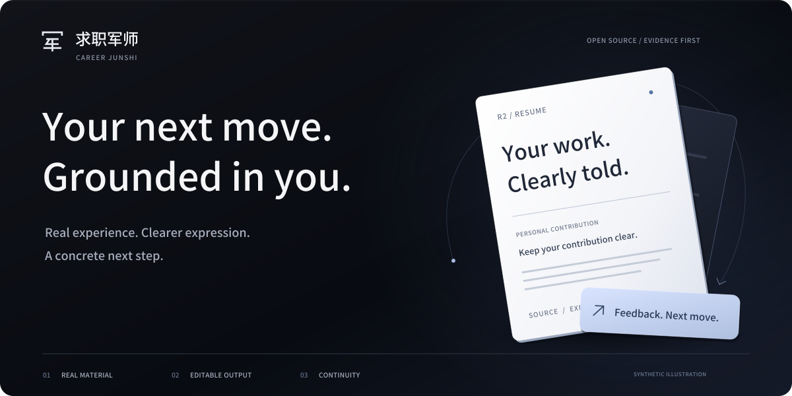
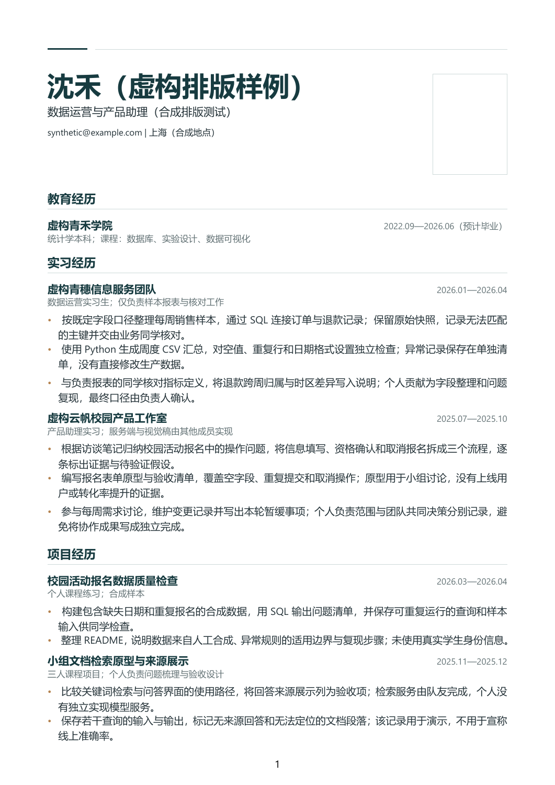
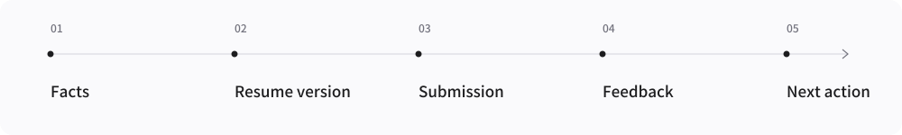

<a id="top"></a>

<div align="center">

[](https://career-junshi.lavinex.chatgpt.site)

# Career Junshi · 求职军师

A career decision Skill for your assistant. Real experience, clearer expression, and a concrete next step.

<p align="center">
  <a href="https://career-junshi.lavinex.chatgpt.site"></a>
  &nbsp;
  <a href="#start"></a>
</p>

[Resume sample](#resume-export) &nbsp; · &nbsp; [中文](README.md)

<sub>[MIT](LICENSE) &nbsp; · &nbsp; Python 3.10+ &nbsp; · &nbsp; [Opt-in memory](documentation/MEMORY.md)</sub>

</div>

---

[01 Preview](#demo) · [02 Start](#start) · [03 Choose](#experiences) · [04 Export](#resume-export) · [05 Continue](#journey) · [06 Verify](#evaluation) · [07 Boundaries](#boundaries)

<a id="demo"></a>

## 01 / Experience you can explain

> **Original:** “Independently built a production RAG platform, improving accuracy by 30%.”

The actual account: a team course prototype. You wrote evaluation scripts and classified
failures; a teammate built the service. Ten internal questions, no baseline, no production users.
Junshi asks about your work and the evaluation criteria before suggesting usable wording:

> Contributed to a team RAG course prototype, owning evaluation scripts and failure
> classification; evaluated ten internal questions against team-agreed criteria and
> recorded missing citations, incorrect passages, and contradictions with source documents.

You leave with **clear ownership, evidence still to gather and a concrete next step**.

<sub>Adapted from an actual host trial with synthetic material, not a real resume or hiring outcome. [Trial record](documentation/EVOLUTION_EVAL.md)</sub>

<details>
<summary>See the follow-up question</summary>

```text
Junshi: For those ten questions, what made an answer count as a failure?

You: My teammate and I agreed on three checks: missing citations,
     incorrect cited passages, or contradictions with the document.
     I put the checks in the script and recorded the results.

Junshi: Your contribution is clearer. It remains your account;
        the code and evaluation records still need checking.
```

The [full defense walkthrough](cases/experiences/defense/example.md) is a separately authored synthetic case.

</details>

<a id="start"></a>

## 02 / Two steps to begin

### 1. Install in your assistant

Send this to Codex or another host that supports local Skills:

```text
Install career-junshi from the main branch of
https://github.com/lavine888/Career-Junshi using the repository installer.
Check for an existing installation first; do not overwrite it.
Validate the installed runtime files. Do not enable persistent memory.
```

<details>
<summary>Manual installation · Python 3.10+ · standard library only</summary>

```sh
git clone --branch main https://github.com/lavine888/Career-Junshi.git
cd Career-Junshi
python scripts/validate_skill.py
python scripts/install_skill.py --target /path/to/your/skills/career-junshi
python /path/to/your/skills/career-junshi/scripts/validate_skill.py --runtime-only
```

Replace `/path/to/your/skills` with a directory your host discovers, including on Windows.
The target folder must be named `career-junshi`; existing targets are preserved and refused.
Installation copies runtime files and license notices, excluding cases, tests, `.git`
and databases. It does not enable memory. Installation paths and package resources must use real directories;
symlinks and Windows junctions are rejected before external files can enter the runtime copy.

</details>

### 2. Bring one real experience

Start with a resume, one experience or a GitHub link. If you only have GitHub:

```text
Use $career-junshi. My target is [role direction], and my GitHub is [link].
Choose one project to open with, draft a short introduction, and guide one small next step.
I have no prepared resume or chosen JD yet. Do not create files or enable memory.
```

[Synthetic project-only starting example, in Chinese](cases/experiences/public-projects/example.md).

If you have an experience to rewrite:

```text
Use $career-junshi to rewrite this experience.

My resume says: ...
What I actually did: ...
Target role / JD: ...
Next interview or deadline: ...

Give me usable wording, reasons for material changes and the best next evidence task.
```

A complete resume is optional; leave the JD or deadline blank if unknown.
Junshi uses existing material first and asks only for consequential missing facts.
For interview practice, add “Run a resume defense session, one question at a time.”

<a id="experiences"></a>

## 03 / Four entry points. Shared facts.

| Core experience | Ask this | What you get |
| --- | --- | --- |
| **Resume defense** · A project may unravel under questions | “Challenge this claim, one question at a time.” | Personal contribution, evidence gaps, usable wording |
| **Role translation** · One project, different jobs | “Adapt this to two JDs. Explain what each version keeps.” | Shared facts, role versions, editing rationale |
| **Evidence sprint** · You know the gap, not how to close it | “I have four hours this week. Close one key gap.” | A deliverable, acceptance criteria, a budget, a stopping point |
| **Decision review** · Feedback changes the picture | “Compare the last advice with this feedback.” | Prior judgment versus observations, a revised action |

Enter at any point and stop whenever you need. Role versions keep the same facts.

Synthetic walkthroughs, in Chinese: [defense](cases/experiences/defense/example.md) ·
[role translation](cases/experiences/role-translation/example.md) ·
[evidence sprint](cases/experiences/proof-sprint/example.md) · [decision review](cases/experiences/decision-review/example.md)

### Before and after the interview

| Stage | Ask this | Take away |
| --- | --- | --- |
| **Pre-interview mock** | “Run three project questions, one at a time. Debrief at the end.” | Follow-ups based on actual answers; an explicit switch between coaching and a whole mock |
| **Post-interview review** | “No recording, but I remember this follow-up. Help me review it.” | Separate recalled exchanges, feelings and explicit feedback; choose one next exercise |
| **Compensation discussion** | “HR asked my expectations. Identify the stage, then rehearse my reply.” | Distinguish expectation alignment from offer negotiation; clarify comparable terms, an ask and a fallback |

If choosing a story is the problem, start with one event cue and one opening line;
a large storybank is unnecessary. These stages reuse the same opportunity and
facts. Reviews can lead back to practice; completing an interview does not imply
an offer. The human sends drafts. Files and memory remain off by default.

You can also say “I only want to talk”, “Give me one usable sentence”, or
“Stop, no summary”. The current request controls the response; plans, worksheets
and checkpoints are optional. Missing outcome data does not turn a past decision
into a future plan.

[Three-stage synthetic walkthrough, in Chinese](cases/experiences/interview-loop/example.md).

<details>
<summary>More requests and advanced use</summary>

| Ask this | Junshi helps you |
| --- | --- |
| “Which roles should I prioritize?” | Compare goals, experience and current JDs; choose primary, secondary and exploratory targets |
| “Which JD gaps need clearer writing, evidence or actual practice?” | Separate the gap types and unknowns, check hard constraints, then choose the next action |
| “Which parts of this AI coding record are my contribution?” | Separate personal decisions, AI implementation and execution receipts in a sourced recap |
| “Re-test the retry logic I could not explain, using a different case.” | Keep the criterion, change the scenario and compare actual answers; explanation does not authenticate a claim |
| “Mock this interview. State what the question observes.” | Choose a criterion, ask one question and respond to the actual answer |
| “Second interview tomorrow. Only 90 minutes tonight.” | Focus on the highest risks, 1–3 actions and a stopping point |
| “Five days without an HR reply. Follow up?” | Check the conversation, promised dates and workdays; draft timing, wording and a stop rule |
| “Which offer should I choose? What needs checking first?” | Compare goals and written terms; verify decisive unknowns and actual fee or identity risks |
| “Two resumes got different feedback. Design an application trial.” | Choose comparable opportunities, one intended change, versions, denominators and a window |
| “I have 15 minutes and keep changing templates. Help me start.” | Produce one inspectable result with a cue, a fallback and a firm stopping point |

Synthetic walkthroughs, in Chinese: [JD gaps](cases/experiences/jd-gap/example.md) ·
[AI development recap](cases/experiences/development-recap/example.md) ·
[targeted retry](cases/experiences/interview-retry/example.md). These are authored examples, not independent evaluations.

- **Wording audit:** “Change only unsupported verbs, ownership and causality.” [Example](cases/experiences/wording-audit/example.md)
- **Checkpoints:** “Pause and give me a copyable checkpoint.” Paste it next time; it stays in chat by default. [Example](cases/experiences/defense-resume/example.md)
- **Outcome-blind review:** In a fresh chat without the outcome, supply observations, freeze the initial judgment, then reveal the result. Known outcomes use ordinary review. [Example](cases/experiences/outcome-blind-review/example.md)

Different roles or channels do not establish a template effect; pending applications stay pending.
[Application trial](cases/experiences/job-search-experiment/example.md) · [Action-start card](cases/experiences/action-start/example.md)

</details>

<a id="resume-export"></a>

## 04 / From a rewrite to an editable deliverable

See **original → rewrite → reason → facts still to confirm**, with reasons for moving,
compressing or omitting experiences.

- **Recover personal judgment:** supported choices, reasons and actual deliverables.
- **Shape the opening:** one target-based positioning line and up to two relevant evidence points; fewer when support is thin.
- **Explain the numbers:** distinguish work volume, team outcomes, internal trials and projected savings, retaining measurement limits.

Ten internal test questions describe scope; projected monthly savings remain a forecast.
Neither establishes improved accuracy or realized savings. [Five same-material comparisons, in Chinese](cases/experiences/resume-positioning/example.md)

Then export a single-column resume. The standard style keeps separate date lines;
the editorial style aligns dates with titles, uses ink-green headings and copper details,
and optionally reserves a photo area. Both retain editable source and actual checks.

<p align="center">
  <a href="benchmark/journey-20261021/artifacts/editorial-zh/resume.pdf">
    
  </a>
  <br>
  <sub>Compiled editorial synthetic sample · Photo space reserved · Click to view the PDF</sub>
</p>

<details>
<summary>Copy the resume export request</summary>

```text
Prepare a Chinese single-column resume for this JD, aiming for one page.
Use the editorial style and reserve a photo area.
Preserve real contributions and explain material rewrites and cuts.
Complete ordinary edits. Export LaTeX and plain text to a new private directory I specify.
Compile a PDF if local XeLaTeX is available; report content, compilation, text and visual checks.
```

</details>

| Your next step | Open this file |
| --- | --- |
| Copy or edit content without LaTeX | **`resume.txt`**; paste into Word or another editor. It is plain text, not a Word document |
| Adjust LaTeX layout | **`resume.tex`**, opened in a TeX editor |
| View or submit a PDF | **`resume.pdf`**, if actually generated and checked, with its delivery notes |

Resume, interview preparation, message drafts and continuation files use private locations outside Git and the Skill installation, without symlink or junction paths.

Source and verification JSON files remain available for inspection. Without a compiler,
source and text are still delivered; actual PDF page count and layout remain unverified.

[Two-page sample](benchmark/resume-layout-20261020/artifacts/two-page-zh/resume.pdf) ·
[Long-link sample](benchmark/resume-layout-20261020/artifacts/links-mixed/resume.pdf) ·
[Actual checks](documentation/RESUME_ITERATION_EVAL.md) (all synthetic materials)

<details>
<summary>Compilation and self-check · File locations · Verification limits</summary>

Source export needs no LaTeX. PDF compilation requires local XeLaTeX, CTEX/Fandol,
geometry, hyperref and their dependencies; editorial also uses fontspec, xcolor and
graphicx. To check the standard probe environment, run from the
repository or installed Skill root:

```sh
python scripts/junshi.py resume-doctor
```

The explicit self-check compiles synthetic Chinese and English probes, reports actual
tool paths, versions and PDF text results, and neither reads your resume nor installs packages.
`READY` means the probes passed; `NOT_READY` reports failures. Source export remains available.

The actual resume needs separate content, compiler-log, text coverage, reading-order,
occurrence and per-page visual checks. Choose one or two pages; the helper never silently
shrinks text or cuts substantive content. Unperformed checks stay explicit, and text
extraction does not certify compatibility with every ATS. Private output goes to a new
directory you specify outside Git and the installed Skill.

[Synthetic input and delivery example](cases/experiences/resume-export/example.md) ·
[Full export workflow](references/practical/resume-export.md)

</details>

<a id="journey"></a>

## 05 / Keep the next round connected



- **Retain what happened.** Preserve submitted R1, create corrected R2, and record later attachments separately without counting another initial application.
- **Connect feedback to a specific action.** Role cancellation changes local investment; capability feedback points to practice or evidence.
- **Return with context.** The continuation card keeps the opportunity, actual version, execution status, feedback sources and next action.

<details>
<summary>Copy the prompt for your next conversation</summary>

```text
Use $career-junshi to continue my search.
Here is the previous card / journal. This is what happened since: ...
Compare it with the earlier advice; separate execution from unknowns and pick one next action.
If the resume changes, retain the submitted version and create a new version.
Update the continuation card in chat. Do not enable persistent memory.
```

</details>

Files are created only when you request a private checkpoint. Bring `journey.json`
and `continue.md` back for later work; there is no folder discovery, automatic memory,
application sending or messaging.
[Workflow contract](references/practical/job-search-journey.md) · [Synthetic starting request](cases/experiences/journey/request.md) · [Actual verification](documentation/JOURNEY_EVAL.md)

<a id="evaluation"></a>

## 06 / Verification you can inspect

| Scope | Completed | Evidence |
| --- | --- | --- |
| Automated regression | **286 tests: 285 passed, 1 permission-related skip**, covering Unicode paths, feedback backfills and private memory | [Current evaluation](documentation/HUMAN_LOOP_EVAL.md) |
| Low-burden interaction | Two fresh-context agents, three two-turn scenarios each, plus two post-change boundary requests; synthetic trials | [Actual record](documentation/HUMAN_LOOP_EVAL.md#独立上下文合成试用) |
| GitHub first use | Two fresh-context agents, two turns each, using fixed public material; personal contribution remains unconfirmed | [Current record](documentation/PUBLIC_PROJECT_FIRST_USE_EVAL.md) |
| Interview loop | Authored simulation, debrief and compensation walkthrough; host review, not an independent trial | [Integration checks](documentation/INTERVIEW_COACH_EVAL.md) |
| Fresh-context trial | One agent without chat history, two synthetic turns; one verification wording issue found and narrowed | [Actual record](benchmark/reliability-20261023/forward-trial.md) |
| Gaps, development recap and targeted retry | Three synthetic walkthroughs; new entries checked through installation and routing | [Current record](documentation/EVIDENCE_TO_PRACTICE_EVAL.md) |
| Resume positioning and result nature | **5 synthetic comparisons, 2 compiled PDFs**; host review, not independent evaluation | [Current record](documentation/RESUME_POSITIONING_EVAL.md) |
| Actual PDF compilation | **4 cases, 8 pages**; three positive cases passed, over-budget output rejected | [Layout stress checks](benchmark/resume-layout-20261020/README.md) |
| Journey and layouts | **3 synthetic PDFs, 3 pages**; a fresh-context subagent completed a two-turn continuation trial | [Journey evaluation](documentation/JOURNEY_EVAL.md) |
| Synthetic user interactions | **5 users, 15 actual assistant turns** | [Multi-turn trials](documentation/MOCK_USER_TRIALS.md) |

There are also 13 structured synthetic benchmark cases and limited fresh-context trials.
These results do not establish improved interview or offer rates.

<details>
<summary>Earlier evaluations and known limits</summary>

| Scope | Record |
| --- | --- |
| Four core experiences | [Core evaluation](documentation/EVOLUTION_EVAL.md) |
| Wording, checkpoints and outcome-blind review | [Refinement evaluation](documentation/REFINEMENT_EVAL.md) |
| Resume source export and PDF limits | [Export evaluation](documentation/RESUME_EXPORT_EVAL.md) |
| Application trials, action starts and research transfer | [Research-workflow evaluation](documentation/RESEARCH_EVOLUTION_EVAL.md) |
| Sources, structured interviews and offer checks | [Career-library evaluation](documentation/CAREER_LIBRARY_EVAL.md) |
| File selection for novice and LaTeX users | [Handoff refinement](documentation/EXPORT_HANDOFF_EVAL.md) |
| Rewrite comparisons, probes and actual compilation | [Iteration evaluation](documentation/RESUME_ITERATION_EVAL.md) |

Existing frozen cases retain extraction, handoff and generalization weaknesses. They have not
all been rerun, and the earlier real-user pilot gates are not claimed as met. Current hiring,
salary and company facts need fresh sources. There is no overall candidate score or hiring probability.

[Evaluation protocol](documentation/EVAL.md) · [Frozen holdouts](documentation/V023_HOLDOUT_EVAL.md) · [Experience plan](documentation/EVOLUTION_PLAN.md)

</details>

<a id="boundaries"></a>
<a id="library"></a>

## 07 / Facts, memory and user control

**Traceable facts. Opt-in memory. External actions stay yours.**

<details>
<summary>Can I start without a complete resume, a JD or LaTeX?</summary>

Yes. Bring a project, a hiring message or a specific question. Without a JD, role recommendations remain hypotheses to test.
Without XeLaTeX, source and plain text remain available; the PDF stays uncompiled and unverified.

</details>

<details>
<summary>Will it remember me? Where does material go?</summary>

Not automatically across conversations. Bring the continuation card or private record you explicitly requested; personal folders are not discovered automatically.

Persistent memory requires separate consent and excludes full resumes, JDs and conversations by default. Viewing, pausing, revoking and deleting are supported.
The local database is unencrypted; deletion cannot erase external backups. Conversations remain subject to the host's data policies.

[Memory guide](documentation/MEMORY.md) · [Evidence contract](documentation/EVIDENCE.md)

</details>

<details>
<summary>What supports the advice, and what remains uncertain?</summary>

The career library contains 18 distinct studies and official documents across eight topics. Each record states reading depth, scope and limits.
Ask: “What supports this advice, and where does it not apply?”

Current hiring, salary, company and individual legal facts need fresh applicable sources. One silence or rejection cannot establish a career-wide verdict. There is no overall candidate score or hiring probability.

[Career library](references/knowledge/08-research-and-application.md)

</details>

<details>
<summary>Will it apply, send messages or accept an offer for me?</summary>

Junshi prepares materials, message drafts and next actions. You decide and carry out applications, messages, negotiation, offer acceptance and sharing.
Reports stay in chat unless you request files and specify a destination. Current checks do not establish improved interview or offer rates.

</details>

---

## Development and documentation

[Skill entrypoint](SKILL.md) · [Playbooks](references) · [Synthetic cases](cases) ·
[Architecture](documentation/ARCHITECTURE.md) · [Issues and ideas](https://github.com/lavine888/Career-Junshi/issues)

<details>
<summary>Commands and implementation notes</summary>

The host understands context and conducts conversations. Python supplies bounded structured
support, artifacts and optional memory. `route --experience` selects references; it does not
run a conversation or generate a report.

```sh
python -m unittest discover -s tests -v
python scripts/validate_skill.py
python scripts/benchmark.py run
python scripts/junshi.py route --mode interview --experience defense
python scripts/junshi.py sources --topic interview
python scripts/junshi.py sources --id R7
```

[Tests](tests) · [Extraction](documentation/CONTEXT_EXTRACTION.md) · [Decision contracts](documentation/DECISION_INTELLIGENCE.md) · [Optional snapshot import](documentation/INTEGRATION.md)

The separate [v0.3 Host-First experiment](https://github.com/lavine888/Career-Junshi/tree/experiment/v0.3-host-first)
is incomplete; its results do not establish an architectural conclusion for the current version.

</details>

---

<div align="center">

[Website ↗](https://career-junshi.lavinex.chatgpt.site) · [GitHub Issues](https://github.com/lavine888/Career-Junshi/issues) · [MIT](LICENSE) · [Back to top ↑](#top)

</div>
