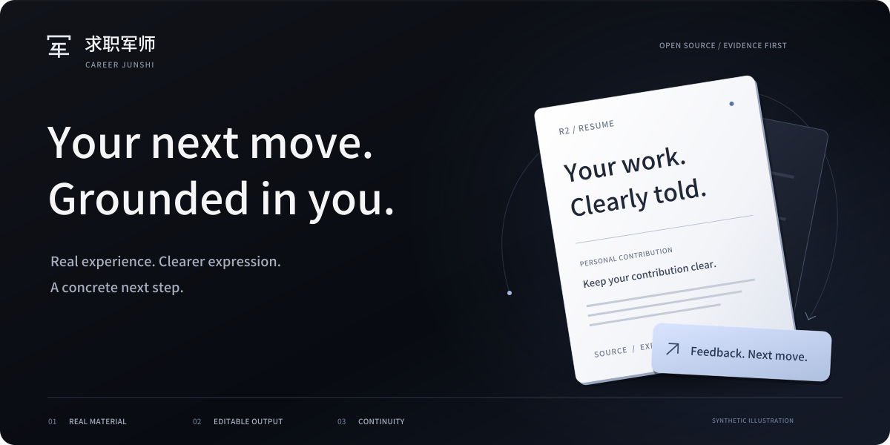
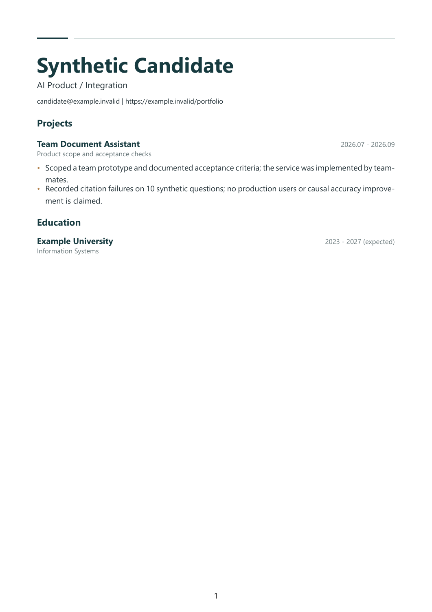

<a id="top"></a>

<div align="center">

[](#start)

**Build with AI. Defend with understanding.**

<sub>Career Junshi · 求职军师 — a career Skill for your assistant. Start with what you have.</sub>

<p>
  <a href="#start"></a>
</p>

[Quick start](#start) &nbsp; · &nbsp; [Sample output](#demo) &nbsp; · &nbsp; [Application companion](#autofill) &nbsp; · &nbsp; [FAQ](#boundaries) &nbsp; · &nbsp; [中文](README.md)

</div>

---

## Who is this for?

For job seekers who have built projects but struggle to describe their contribution or defend it in an interview — especially when AI coding and teammates were involved.

Career-Junshi is a career coach inside Codex and other assistants that support local Skills. Bring one project, get usable wording, then practice a real follow-up. No full resume or career framework required.

<a id="start"></a>

## Quick start: install, then bring one experience

### 1. Install in your assistant

Send this to Codex or another assistant that supports local Skills and can run local commands. The installer needs Python 3.10+:

```text
Install career-junshi from the main branch of
https://github.com/lavine888/Career-Junshi using the repository installer.
Check for an existing installation first; do not overwrite it.
Validate the installed runtime files. Do not enable persistent memory.
```

### 2. Bring something you already have

```text
Use $career-junshi.
Here is one project experience: ...
Help me explain my contribution. If there is enough material, draft usable wording first.
Ask one targeted follow-up, wait for my answer, then revise that wording.
Stay in chat; do not create files or enable persistent memory.
```

**The first session should complete:** your experience → usable wording → one targeted question → wording revised from your answer.

No full resume or JD is required. If material is missing, ask only the decisive question.
[GitHub-only starting example, in Chinese](cases/experiences/public-projects/example.md).
If the assistant cannot invoke the Skill, ask it to check whether the installation directory is one that the current host reads.

<details>
<summary>Manual installation · Git and Python 3.10+ required · standard library only</summary>

```sh
git clone --branch main https://github.com/lavine888/Career-Junshi.git
cd Career-Junshi
python scripts/validate_skill.py
python scripts/install_skill.py --target /path/to/your/skills/career-junshi
python /path/to/your/skills/career-junshi/scripts/validate_skill.py --runtime-only
```

Use a directory your host discovers, including on Windows. The destination must
be named `career-junshi`; existing targets are preserved and refused. Installation
copies runtime files and licenses, excluding cases, tests, `.git` and databases.
Memory stays off. Paths containing symlinks or Windows junctions are refused.

</details>

<a id="demo"></a>

## Sample output: make the contribution clear

> **Original:** “Independently built a production RAG platform, improving accuracy by 30%.”

The supplied account describes a team course prototype: you wrote evaluation
scripts and classified failures; a teammate built the service. Ten internal
questions, no baseline and no production users. After clarifying your work and criteria:

> Contributed to a team RAG course prototype, owning evaluation scripts and failure
> classification; evaluated ten internal questions against team-agreed criteria and
> recorded missing citations, incorrect passages, and contradictions with source documents.

**Usable wording, with the remaining evidence gap visible.** Missing outcome data
does not erase completed work or justify inventing results.

<sub>Adapted from an actual host trial with synthetic material, not a real resume or hiring outcome. [Trial record](documentation/EVOLUTION_EVAL.md)</sub>

<details>
<summary>See the question behind this rewrite</summary>

```text
Junshi: For those ten questions, what made an answer count as a failure?

You: My teammate and I agreed on three checks: missing citations,
     incorrect cited passages, or contradictions with the document.
     I put the checks in the script and recorded the results.

Junshi: Your contribution is clearer. It remains your account;
        the code and evaluation records still need checking.
```

The [full defense walkthrough](cases/experiences/defense/example.md), in Chinese,
is a separately authored synthetic example.

</details>

<a id="experiences"></a>
<a id="interview-loop"></a>

## Four things you can do

| Where you are stuck | Just ask | What you get |
| --- | --- | --- |
| Explaining a project | "Rewrite this experience without inventing my contribution." | Usable wording and one targeted question |
| Choosing roles | "Is this JD worth applying to?" | Decision, decisive gaps and next step |
| Interview preparation | "Ask me one question at a time about this project." | Feedback on actual answers and variant practice |
| Feedback or an offer | "Here's what happened. Help me choose my next move." | Debrief, priorities or offer trade-offs |

Ask for one sentence, practice one question at a time, or stop whenever you want. No internal workflow names to learn.

[More synthetic examples](cases/experiences) · [Full routing index](references/practical/00-router.md)

<a id="journey"></a>

## Make each round useful for the next

**Real experience → resume version → actual application → feedback → next step**

A new resume never overwrites a submitted version. Interview feedback is not proof of why a hiring decision occurred. Work stays in chat by default; ask for a compact checkpoint when you want to carry it to a new conversation.

> Use $career-junshi to continue my search. Here is my last checkpoint, and this is what happened: ... Give me the most useful next step.

Persistent memory requires separate consent and stays off by default. [Continuation](references/practical/job-search-journey.md) · [Memory and privacy](documentation/MEMORY.md)

<a id="resume-export"></a>

<details>
<summary>Need resume files? See the LaTeX / PDF sample and export request</summary>

### A resume you can keep editing

Keep the same facts from role-specific writing through layout. Export **LaTeX
source and plain text**; compile and inspect a PDF when XeLaTeX is available.
The editorial layout can leave space for a photo.

<p align="center">
  <a href="benchmark/journey-20261021/artifacts/editorial-en/resume.pdf">
    
  </a>
  <br>
  <sub>Compiled synthetic sample · optional photo area · click to open PDF</sub>
</p>

<p align="center">
  <a href="benchmark/journey-20261021/artifacts/editorial-en/resume.pdf">Open PDF ↗</a>
  &nbsp; · &nbsp;
  <a href="benchmark/journey-20261021/artifacts/editorial-en/resume.tex">View LaTeX source</a>
</p>

**Copy this request:**

```text
Use $career-junshi to tailor a single-column English resume to this JD,
preferably one page. Use the editorial layout and leave a blank photo area.
Keep actual contributions; explain material edits and omissions.
Export LaTeX source and plain text to a new private directory I specify.
If XeLaTeX is available, compile a PDF and report content, compilation,
text-layer and visual checks separately.
```

`resume.txt` can be pasted into Word or another editor; it is plain text, not a
Word document. Edit layout in `resume.tex`. A `resume.pdf` is delivered only
after it has actually been generated and checked. Personal files go to your
chosen private directory outside Git checkouts and the Skill installation.

</details>

<a id="autofill"></a>

## Optional: reduce repeated application-form typing

[Download the application companion v0.3.2 with local OCR / PDF assets](https://github.com/lavine888/Career-Junshi/releases/download/autofill-v0.3.2/junshi-autofill-0.3.2.zip)

Read a selected resume locally in Edge / Chrome, match Chinese or English fields, and fill supported empty fields. **Local mode needs no model API key**; local OCR supports images and scanned PDFs. Fill, Records and Settings have separate views. Model setup is optional.

1. Download and unzip the archive. Keep the extracted `junshi-autofill` folder.
2. Open `edge://extensions` or `chrome://extensions`, enable Developer mode, choose “Load unpacked”, and select the folder containing `manifest.json`.
3. Open an application form and click the extension icon: **import and check your resume → fill matched fields → inspect the page → submit yourself → confirm the application record**.

Optionally connect DeepSeek / GLM-compatible APIs. Only field descriptors are sent by default; sending resume content requires explicit opt-in and preview. You can also hand complex fields to your existing assistant. Review model output first; approve open-answer drafts individually. Export a selected application record back to Junshi for interview preparation or follow-up.

Employer compatibility is not guaranteed. OCR reads text; it does not understand open questions. Custom controls, uploads and uncertain fields need manual handling. The companion never submits the form.

**Upgrading:** back up records, replace files in the existing loaded folder, then reload without uninstalling. This upgrade requires reimporting the resume; application history is preserved.

[Full guide and limitations, in Chinese](extensions/autofill/README.md) · [Optional API setup, in Chinese](extensions/autofill/README.md#可选接入国内模型-api)

<a id="evaluation"></a>

## Validation status

- Historical software regression: 286 tests, 285 passed, one skipped for file symlink permissions. [Record](documentation/HUMAN_LOOP_EVAL.md)
- Synthetic multi-turn trials, actual resume PDF compilation and boundary checks are documented. [Evaluation index](documentation/EVAL.md) · [Resume layout](benchmark/resume-layout-20261020/README.md)
- The five-person first-use comparison has not collected real-user results. [Trial protocol](documentation/EVAL.md#core-first-use-trial)

These are earlier-version records, not a rerun of the simplified release. They do not establish improved interview pass rates, offer rates or negotiation outcomes. Frozen cases retain extraction, handoff and generalization limitations. [Frozen holdout](documentation/V023_HOLDOUT_EVAL.md)

<a id="boundaries"></a>
<a id="library"></a>

## FAQ

<details>
<summary>Can I start without a JD, full resume or LaTeX?</summary>

Yes. Bring one experience, project link or recruiting message. Without a JD,
role advice remains a hypothesis to check. Without XeLaTeX, source and plain text
are still available; the PDF remains uncompiled and unverified.

PDF generation needs XeLaTeX, CTEX/Fandol, geometry, hyperref and dependencies;
the editorial layout also uses fontspec, xcolor and graphicx.
`python scripts/junshi.py resume-doctor` compiles small Chinese and English
synthetic fixtures to check the environment, without reading your resume or
installing components. `READY` applies to those fixtures; the actual resume needs
separate checks. Text extraction is not universal ATS certification.
[Full export workflow](references/practical/resume-export.md)

</details>

<details>
<summary>Does it remember me, submit applications or send messages?</summary>

Not automatically. Bring back a checkpoint to continue; the Skill does not
discover your personal folders. Persistent memory requires separate consent and
supports viewing, pausing, revoking and deleting. Full resumes, JDs and chats are
not stored by default. The database stays outside Git and the installation and
is unencrypted; deletion cannot erase external backups. Host data policies still apply.

Junshi prepares materials and drafts. You submit, send, negotiate and decide.
[Memory details](documentation/MEMORY.md) · [Evidence contract](documentation/EVIDENCE.md)

</details>

<details>
<summary>What supports the advice, and what remains unknown?</summary>

The [career research library](references/knowledge/08-research-and-application.md)
records reading depth, scope and limits for research and official sources.
Ask: “What supports this advice, and when would it not apply?”

Current hiring, company, salary and case-specific legal claims need fresh sources.
Responsibilities, metrics and ownership are not invented. A single silence or
rejection does not settle a career direction; no composite candidate score or
hiring probability is provided.

</details>

---

<details>
<summary>Developer entry points and manual verification</summary>

[Skill entry](SKILL.md) · [Task guides](references) · [Synthetic cases](cases) ·
[Architecture](documentation/ARCHITECTURE.md) · [Issues](https://github.com/lavine888/Career-Junshi/issues)

The host interprets material and conducts the conversation. Python provides
bounded structured helpers, artifacts and optional local memory.
`route --experience` selects references; it does not run a conversation or create a report.

```sh
python -m unittest discover -s tests -v
python scripts/validate_skill.py
python scripts/benchmark.py run
python scripts/junshi.py route --mode interview --experience defense
python scripts/junshi.py sources --topic interview
```

Companion checks and limits are in the [extension guide, in Chinese](extensions/autofill/README.md#边界与验证). The Python commands above do not run the extension browser tests.

[Extraction contract](documentation/CONTEXT_EXTRACTION.md) ·
[Decision contract](documentation/DECISION_INTELLIGENCE.md) ·
[Optional snapshot integration](documentation/INTEGRATION.md)

The separate [v0.3 Host-First experiment](https://github.com/lavine888/Career-Junshi/tree/experiment/v0.3-host-first)
is unfinished; its results do not establish conclusions about the current architecture.

</details>

<div align="center">

[Start this round ↑](#start) &nbsp; · &nbsp; [Website ↗](https://career-junshi.lavinex.chatgpt.site) &nbsp; · &nbsp; [GitHub Issues](https://github.com/lavine888/Career-Junshi/issues)

<sub>[MIT](LICENSE) · Python 3.10+ · [中文](README.md) · [Back to top](#top)</sub>

</div>
