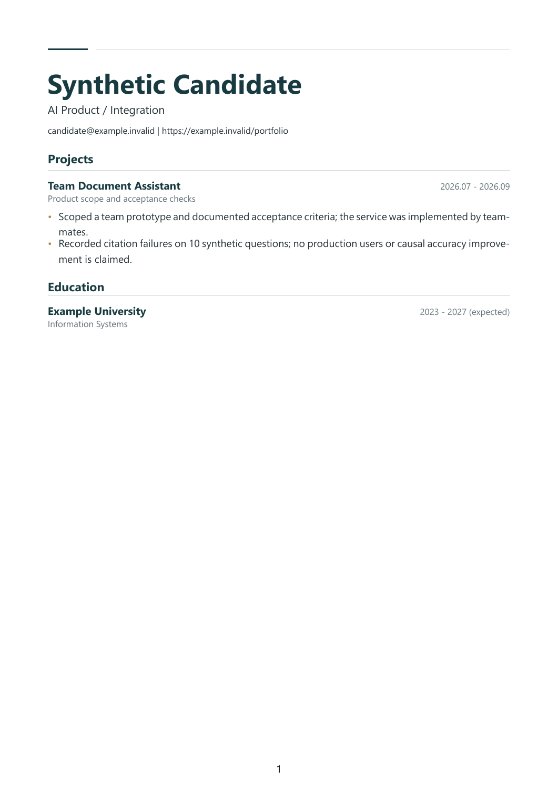

<a id="top"></a>

<div align="center">

[](#start)

**Explain your experience clearly. Practise for your next interview.**

<sub>Career Junshi · 求职军师 — a career Skill for your assistant. Start with what you have.</sub>

<p>
  <a href="#start"></a>
</p>

[See the output](#demo) &nbsp; · &nbsp; [Website ↗](https://career-junshi.lavinex.chatgpt.site) &nbsp; · &nbsp; [中文](README.md)

</div>

---

<a id="demo"></a>

## See what you leave with

### An experience you can explain

> **Original:** “Independently built a production RAG platform, improving accuracy by 30%.”

The supplied account describes a team course prototype: you wrote evaluation
scripts and classified failures; a teammate built the service. Ten internal
questions, no baseline and no production users. After clarifying your work and criteria:

> Contributed to a team RAG course prototype, owning evaluation scripts and failure
> classification; evaluated ten internal questions against team-agreed criteria and
> recorded missing citations, incorrect passages, and contradictions with source documents.

**Usable wording, with the remaining evidence gap visible.** Missing outcome data
does not erase completed work or justify inventing results.

<sub>Adapted from an actual host trial with synthetic material, not a real resume or hiring outcome. [Trial record](documentation/EVOLUTION_EVAL.md)</sub>

<details>
<summary>See the question behind this rewrite</summary>

```text
Junshi: For those ten questions, what made an answer count as a failure?

You: My teammate and I agreed on three checks: missing citations,
     incorrect cited passages, or contradictions with the document.
     I put the checks in the script and recorded the results.

Junshi: Your contribution is clearer. It remains your account;
        the code and evaluation records still need checking.
```

The [full defense walkthrough](cases/experiences/defense/example.md), in Chinese,
is a separately authored synthetic example.

</details>

<a id="resume-export"></a>

### A resume you can keep editing

Keep the same facts from role-specific writing through layout. Export **LaTeX
source and plain text**; compile and inspect a PDF when XeLaTeX is available.
The editorial layout can leave space for a photo.

<p align="center">
  <a href="benchmark/journey-20261021/artifacts/editorial-en/resume.pdf">
    
  </a>
  <br>
  <sub>Compiled synthetic sample · optional photo area · click to open PDF</sub>
</p>

<p align="center">
  <a href="benchmark/journey-20261021/artifacts/editorial-en/resume.pdf">Open PDF ↗</a>
  &nbsp; · &nbsp;
  <a href="benchmark/journey-20261021/artifacts/editorial-en/resume.tex">View LaTeX source</a>
</p>

<details>
<summary>Copy a resume-export request</summary>

```text
Use $career-junshi to tailor a single-column English resume to this JD,
preferably one page. Use the editorial layout and leave a blank photo area.
Keep actual contributions; explain material edits and omissions.
Export LaTeX source and plain text to a new private directory I specify.
If XeLaTeX is available, compile a PDF and report content, compilation,
text-layer and visual checks separately.
```

`resume.txt` can be pasted into Word or another editor; it is plain text, not a
Word document. Edit layout in `resume.tex`. A `resume.pdf` is delivered only
after it has actually been generated and checked. Personal files go to your
chosen private directory outside Git checkouts and the Skill installation.

</details>

<a id="start"></a>

## Two steps to begin

### 1. Install in your assistant

Send this to Codex or another host that supports local Skills:

```text
Install career-junshi from the main branch of
https://github.com/lavine888/Career-Junshi using the repository installer.
Check for an existing installation first; do not overwrite it.
Validate the installed runtime files. Do not enable persistent memory.
```

<details>
<summary>Manual installation · Python 3.10+ · standard library only</summary>

```sh
git clone --branch main https://github.com/lavine888/Career-Junshi.git
cd Career-Junshi
python scripts/validate_skill.py
python scripts/install_skill.py --target /path/to/your/skills/career-junshi
python /path/to/your/skills/career-junshi/scripts/validate_skill.py --runtime-only
```

Use a directory your host discovers, including on Windows. The destination must
be named `career-junshi`; existing targets are preserved and refused. Installation
copies runtime files and licenses, excluding cases, tests, `.git` and databases.
Memory stays off. Paths containing symlinks or Windows junctions are refused.

</details>

### 2. Bring something you already have

```text
Use $career-junshi. My target is [role direction].
Here is my [resume / project experience / GitHub link]: ...
Give me one usable result first, then guide one small next step.
Do not create files or enable persistent memory yet.
```

A complete resume is unnecessary; leave the JD or deadline blank if unknown.
With only GitHub, start by selecting a project and drafting an introduction;
unclear personal responsibilities still need clarification.
[Project-only starting example, in Chinese](cases/experiences/public-projects/example.md).

<a id="experiences"></a>

## Start where you are stuck

| Your situation | Ask this | Take away |
| --- | --- | --- |
| **The project is real; the resume is unclear** | “Rewrite this experience. Explain what to keep or cut.” | Usable wording, ownership boundaries and reasons for material edits |
| **You want to try the follow-up questions** | “Question this project, one at a time. Hear my answer first.” | Follow-ups based on your actual answer and one practice focus |
| **Feedback arrived; the next move is unclear** | “Compare this feedback with the last advice. Choose a next step.” | Preserve what happened and adjust one concrete action |

> You can also say “I only want to talk”, “Give me one usable sentence” or
> “Stop, no summary”. A plan is optional.

<details>
<summary>The four core experiences and more ways to use Junshi</summary>

- **Resume defense:** “Challenge this claim, one question at a time.” [Example](cases/experiences/defense/example.md)
- **Role translation:** “Adapt this to two JDs. Explain what each version keeps.” [Example](cases/experiences/role-translation/example.md)
- **Evidence sprint:** “I have four hours this week. Close one key gap.” [Example](cases/experiences/proof-sprint/example.md)
- **Decision review:** “Compare the last advice with this feedback.” [Example](cases/experiences/decision-review/example.md)

You can also ask “Which roles should I prioritize?”, “When should I follow up
with HR?” or “Which offer should I choose?”
[Follow-up example](cases/follow-up/request.md) · [Offer comparison](cases/offer/request.md)

Other synthetic walkthroughs, in Chinese:
[JD gaps](cases/experiences/jd-gap/example.md),
[AI development contributions](cases/experiences/development-recap/example.md),
[changed-case retry](cases/experiences/interview-retry/example.md),
[wording audit](cases/experiences/wording-audit/example.md),
[checkpoints](cases/experiences/defense-resume/example.md),
[application trials](cases/experiences/job-search-experiment/example.md) and
[action-start cards](cases/experiences/action-start/example.md).

[Outcome-blind review](cases/experiences/outcome-blind-review/example.md) requires
a context that has not seen the outcome. Results across different roles or
channels do not establish a template effect.

</details>

<a id="interview-loop"></a>

## Before and after the interview

**Before · Simulate the follow-up, then learn from your answer.**<br>
“Run three project questions, one at a time. Debrief at the end.” Switch explicitly
between coached drills and whole mocks. If choosing a story is the problem,
start with one event cue and an opening sentence.

**After · Reconstruct the exchange, then choose one practice point.**<br>
“No recording, but I remember this question.” Separate actual exchanges,
feelings and explicit feedback. A review can lead back to a changed-case drill.

**Compensation · Align the terms, then rehearse the response.**<br>
“HR asked my expectations. Identify the stage, then play HR for one reply.”
Distinguish expectation alignment from offer negotiation, separate fixed pay from
variable terms, and keep your private minimum out of the outgoing draft.
The human sends it.

[Three-stage synthetic walkthrough, in Chinese](cases/experiences/interview-loop/example.md)

<a id="journey"></a>

## Finish this round. Pick up the next.

**Source material → Resume version → Actual application → Feedback → Next step**

A submitted R1 is preserved when R2 is revised; a later attachment is recorded
separately. Old feedback cannot replace the current judgment, and simultaneous
feedback stays visible. A useful checkpoint carries the opportunity, actual
version, feedback source and one unfinished step. You can also stop without a summary.

<details>
<summary>Copy a continuation request</summary>

```text
Use $career-junshi to continue my search.
Here is the previous checkpoint or record. This time: ...
Compare with the earlier advice, distinguish done from unknown,
and suggest one next step. Keep the original submitted resume if revising it.
Update the checkpoint if useful. Stay in chat; do not enable memory.
```


Output stays in chat by default. Explicitly request a private checkpoint to
generate the journal, review and `continue.md`, then bring them back yourself.
[Continuation contract](references/practical/job-search-journey.md) ·
[Synthetic starting point](cases/experiences/journey/request.md) ·
[Actual checks](documentation/JOURNEY_EVAL.md)

</details>

<a id="evaluation"></a>

## See the output. Inspect the evidence.

| Check | Available evidence |
| --- | --- |
| **Software regression** | Latest record: 286 tests, 285 passed and one file-symlink permission skip; Windows junctions were exercised. [Fixes and checks](documentation/HUMAN_LOOP_EVAL.md) |
| **Actual PDF compilation** | Synthetic resumes compiled, text extracted and page counts checked, including an overflow failure case. [Layout checks](benchmark/resume-layout-20261020/README.md) · [Editorial export and continuation](documentation/JOURNEY_EVAL.md) |
| **Synthetic interactions** | Fresh-context agents, multi-turn exchanges and before/after records, with limits stated. [Low-burden interaction](documentation/HUMAN_LOOP_EVAL.md#独立上下文合成试用) · [GitHub first use](documentation/PUBLIC_PROJECT_FIRST_USE_EVAL.md) |

These checks **do not establish better interview, offer or negotiation outcomes**.
Synthetic examples are not user testimonials. Software checks and dialogue trials
are reported separately.

<details>
<summary>All evaluation records and known limitations</summary>

[Interview loop](documentation/INTERVIEW_COACH_EVAL.md) ·
[Five synthetic users, fifteen turns](documentation/MOCK_USER_TRIALS.md) ·
[Positioning and result types](documentation/RESUME_POSITIONING_EVAL.md) ·
[Five rewriting comparisons](cases/experiences/resume-positioning/example.md) ·
[Gaps, development recap and retry](documentation/EVIDENCE_TO_PRACTICE_EVAL.md) ·
[Fresh-context reliability trial](benchmark/reliability-20261023/forward-trial.md) ·
[Core experiences](documentation/EVOLUTION_EVAL.md) ·
[Wording, checkpoints and blind review](documentation/REFINEMENT_EVAL.md) ·
[Resume export](documentation/RESUME_EXPORT_EVAL.md) ·
[Choosing export files](documentation/EXPORT_HANDOFF_EVAL.md) ·
[Resume iteration](documentation/RESUME_ITERATION_EVAL.md) ·
[Research workflows](documentation/RESEARCH_EVOLUTION_EVAL.md) ·
[Career library and offer checks](documentation/CAREER_LIBRARY_EVAL.md).

There are also thirteen structured synthetic benchmarks. Frozen cases retain
weaknesses in extraction, handoff and advice generalization; they have not all
been rerun; we do not claim that the original real-user pilot gates have been met.
[Evaluation protocol](documentation/EVAL.md) · [Frozen holdout](documentation/V023_HOLDOUT_EVAL.md)

</details>

<a id="boundaries"></a>
<a id="library"></a>

## Traceable facts. Your pace.

<details>
<summary>Can I start without a JD, full resume or LaTeX?</summary>

Yes. Bring one experience, project link or recruiting message. Without a JD,
role advice remains a hypothesis to check. Without XeLaTeX, source and plain text
are still available; the PDF remains uncompiled and unverified.

PDF generation needs XeLaTeX, CTEX/Fandol, geometry, hyperref and dependencies;
the editorial layout also uses fontspec, xcolor and graphicx.
`python scripts/junshi.py resume-doctor` compiles small Chinese and English
synthetic fixtures to check the environment, without reading your resume or
installing components. `READY` applies to those fixtures; the actual resume needs
separate checks. Text extraction is not universal ATS certification.
[Full export workflow](references/practical/resume-export.md)

</details>

<details>
<summary>Does it remember me, submit applications or send messages?</summary>

Not automatically. Bring back a checkpoint to continue; the Skill does not
discover your personal folders. Persistent memory requires separate consent and
supports viewing, pausing, revoking and deleting. Full resumes, JDs and chats are
not stored by default. The database stays outside Git and the installation and
is unencrypted; deletion cannot erase external backups. Host data policies still apply.

Junshi prepares materials and drafts. You submit, send, negotiate and decide.
[Memory details](documentation/MEMORY.md) · [Evidence contract](documentation/EVIDENCE.md)

</details>

<details>
<summary>What supports the advice, and what remains unknown?</summary>

The [career research library](references/knowledge/08-research-and-application.md)
records reading depth, scope and limits for research and official sources.
Ask: “What supports this advice, and when would it not apply?”

Current hiring, company, salary and case-specific legal claims need fresh sources.
Responsibilities, metrics and ownership are not invented. A single silence or
rejection does not settle a career direction; no composite candidate score or
hiring probability is provided.

</details>

---

<details>
<summary>Developer entry points and manual verification</summary>

[Skill entry](SKILL.md) · [Task guides](references) · [Synthetic cases](cases) ·
[Architecture](documentation/ARCHITECTURE.md) · [Issues](https://github.com/lavine888/Career-Junshi/issues)

The host interprets material and conducts the conversation. Python provides
bounded structured helpers, artifacts and optional local memory.
`route --experience` selects references; it does not run a conversation or create a report.

```sh
python -m unittest discover -s tests -v
python scripts/validate_skill.py
python scripts/benchmark.py run
python scripts/junshi.py route --mode interview --experience defense
python scripts/junshi.py sources --topic interview
```

[Extraction contract](documentation/CONTEXT_EXTRACTION.md) ·
[Decision contract](documentation/DECISION_INTELLIGENCE.md) ·
[Optional snapshot integration](documentation/INTEGRATION.md)

The separate [v0.3 Host-First experiment](https://github.com/lavine888/Career-Junshi/tree/experiment/v0.3-host-first)
is unfinished; its results do not establish conclusions about the current architecture.

</details>

<div align="center">

[Start this round ↑](#start) &nbsp; · &nbsp; [Website ↗](https://career-junshi.lavinex.chatgpt.site) &nbsp; · &nbsp; [GitHub Issues](https://github.com/lavine888/Career-Junshi/issues)

<sub>[MIT](LICENSE) · Python 3.10+ · [中文](README.md) · [Back to top](#top)</sub>

</div>
